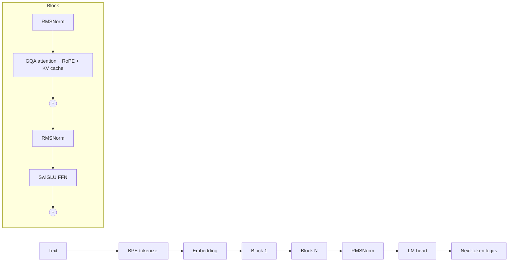

# 🧠 LLM From Scratch

**Build a modern Large Language Model from zero — tokenizer, Transformer, pre-training, sampling,
LoRA fine-tuning, DPO alignment, quantization and an OpenAI-compatible API — in ~1,000 lines of
readable PyTorch. Then use it like any other LLM.**

The repo keeps itself current: a weekly **LLM Radar** bot tracks new releases across the LLM
ecosystem and new arXiv papers, and opens a Pull Request with what changed.
→ see [`docs/LLM_RADAR.md`](docs/LLM_RADAR.md)

---

## 🗺️ The course

| # | Chapter | You build | Code | Branch |
|---|---|---|---|---|
| 1 | [Tokenization](docs/01-tokenizer.md) | byte-level BPE (GPT-4 style) | `llm/tokenizer.py` | `chapter/01-tokenizer` |
| 2 | [The Transformer](docs/02-transformer.md) | Llama-style decoder: RMSNorm, RoPE, GQA, SwiGLU, KV cache | `llm/model.py` | `chapter/02-transformer` |
| 3 | [Pre-training](docs/03-pretraining.md) | data pipeline, AdamW, warm-up + cosine, bf16, checkpoints | `llm/trainer.py` | `chapter/03-pretraining` |
| 4 | [Inference](docs/04-inference.md) | greedy / temperature / top-k / top-p, streaming | `llm/generate.py` | `chapter/04-inference` |
| 5 | [Fine-tuning](docs/05-finetuning.md) | chat template, SFT, **LoRA**, **DPO** | `llm/lora.py`, `llm/finetune.py` | `chapter/05-finetuning` |
| 6 | [Serving](docs/06-serving.md) | int8 quantization, **OpenAI-compatible API** with SSE streaming | `llm/serve.py`, `llm/quantize.py` | `chapter/06-serving` |
| 7 | [Apps](docs/07-apps.md) | RAG, tool use, agents, MCP on top of your model | 🚧 | `chapter/07-apps` |

Each `chapter/*` branch contains the project **only up to that chapter**, so you can check one
out and build the next piece yourself, then compare with the next branch.

## ⚡ Quick start (≈5 minutes on a laptop CPU)

```bash
git clone https://github.com/<you>/llm-from-scratch && cd llm-from-scratch
pip install torch && pip install -r requirements.txt

python scripts/prepare_data.py                       # 1. download Tiny Shakespeare + train tokenizer
python scripts/train.py --preset nano --steps 600    # 2. pre-train (~2.5 min CPU)
python scripts/chat.py                               # 3. generate text
python scripts/finetune.py --dpo data/dpo_example.jsonl   # 4. LoRA-SFT + DPO -> assistant
python -m llm.serve --ckpt checkpoints/sft.pt        # 5. serve at http://localhost:8000/v1
```

Reference run (nano, 0.9M params, CPU): validation perplexity **512 → 15** in 600 steps, then:

```
ROMEO:
O, I say, there is advoces marry of earth.
Come, poor tremble friend! My rust and wrinks ...
```

After SFT, `"Say hello."` → `"Hello! How can I help you today?"`

## 🔌 Use it like any LLM

```python
from openai import OpenAI
client = OpenAI(base_url="http://localhost:8000/v1", api_key="none")
print(client.chat.completions.create(
    model="tiny-llm", messages=[{"role": "user", "content": "What is LoRA?"}]
).choices[0].message.content)
```

Or straight from Python:
```python
from llm.trainer import load_checkpoint
from llm.tokenizer import BPETokenizer
from llm.generate import generate
model = load_checkpoint("checkpoints/best.pt")
tok = BPETokenizer.load("checkpoints/tokenizer.json")
print(generate(model, tok, "JULIET:", max_new_tokens=100, temperature=0.8, top_p=0.95))
```

## 🏗️ Architecture



## 🌿 Branches

| Branch | Purpose |
|---|---|
| `main` | stable, complete, all tests green |
| `develop` | integration branch — features and Radar PRs land here first |
| `chapter/01-tokenizer` … `chapter/07-apps` | step-by-step snapshots of the course |
| `feature/mixture-of-experts` | 🚧 MoE feed-forward (DeepSeek / Mixtral style) |
| `feature/grpo-reasoning` | 🚧 GRPO reinforcement learning for reasoning |
| `feature/speculative-decoding` | 🚧 draft-model speculative decoding |
| `feature/rag-agent` | 🚧 RAG + tool-calling agent on the local API |
| `radar/weekly-update` | created automatically by the LLM Radar bot |

See [CONTRIBUTING.md](CONTRIBUTING.md) for the workflow.

## 📡 Staying up to date

`.github/workflows/llm-radar.yml` runs every Monday (or on demand):
1. checks the latest release of ~25 key tools (vLLM, llama.cpp, PEFT, TRL, Unsloth, FlashAttention, MCP, ...)
2. pulls the newest LLM papers from arXiv
3. regenerates [`docs/LLM_RADAR.md`](docs/LLM_RADAR.md) and opens a PR into `develop` listing every new release, linked to the chapter it relates to

Add a tool to follow in [`radar/watchlist.json`](radar/watchlist.json).

## 🧪 Tests
```bash
pytest -q tests     # tokenizer round-trip, KV-cache == full forward, loss decreases,
                    # LoRA merge is exact, int8 ≈ fp32, API returns OpenAI format
```

## 📚 Further reading
- Vaswani et al., *Attention Is All You Need* (2017)
- Su et al., *RoFormer: Rotary Position Embedding* (2021)
- Hu et al., *LoRA* (2021) · Rafailov et al., *Direct Preference Optimization* (2023)
- Ainslie et al., *GQA* (2023) · Shazeer, *GLU Variants Improve Transformer* (2020)
- Karpathy, *nanoGPT* / *minbpe* — big inspiration for the teaching style

## License
MIT
